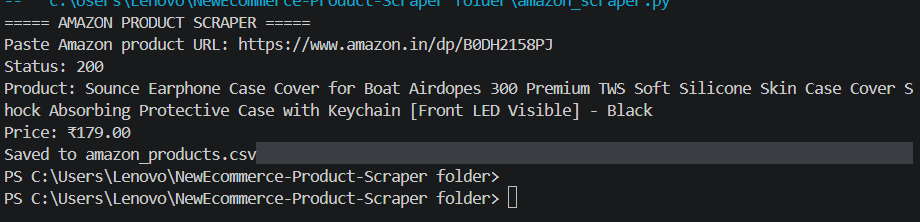
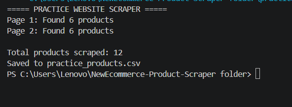

E-Commerce Product Scraper 🛒

About the Project

This is a Python-based web scraping project that extracts product names and prices from e-commerce websites.

Projects Included

1. Amazon Product Scraper

- Accepts an Amazon product URL.
- Attempts to extract product names and prices.
- Saves results in CSV format.

2. Practice Website Scraper

- Extracts laptop names and prices.
- Scrapes multiple pages.
- Saves product details into a CSV file.

  ## Project Screenshots

### Amazon Product Scraper

### Practice Website Scraper

Technologies Used

- Python
- Requests
- BeautifulSoup
- CSV

Installation

Install the required libraries:

py -m pip install requests beautifulsoup4

How to Run

Amazon Scraper:

py amazon_scraper.py

Practice Scraper:

py practice_scraper.py

Output Files

- amazon_products.csv
- practice_products.csv

Author

Rakshita

Disclaimer

This project is for educational purposes. Website access restrictions and terms of service must be respected.
